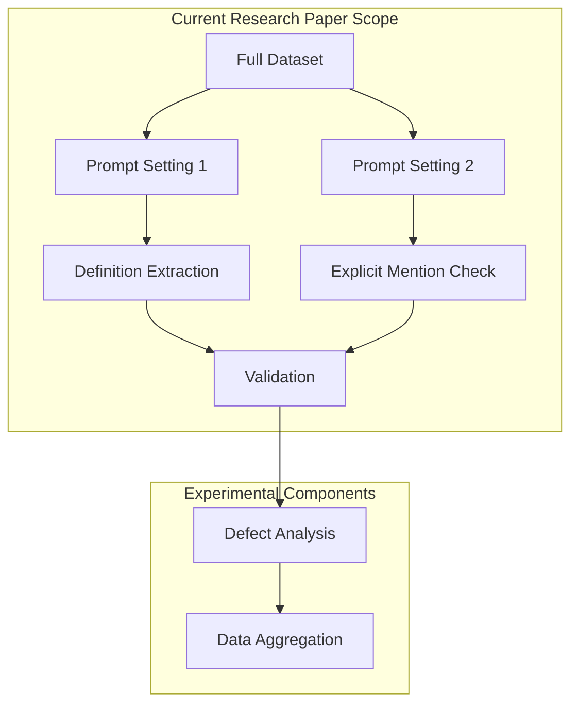

# RAAC LLM Analysis Code Package

[](https://www.python.org/downloads/)
[](https://creativecommons.org/licenses/by-nc/4.0/)
[](https://doi.org/xxxx/UBIRA_RAAC_LLM)

## Author Information

**Author:** Dr Lixu Liu  
**Position:** Research Fellow  
**Contact:**

- Academic: l.liu.9@bham.ac.uk; l.liu2@lboro.ac.uk
- Professional: lixu@verdemetrix.com

**Affiliations:**

- Department of Civil Engineering, University of Birmingham
- School of Architecture, Building and Civil Engineering, Loughborough University
- Centre for Postdoctoral Development in Infrastructure, Cities and Energy (C-DICE)
- RAAC Monitoring Team, Loughborough University

## 📄 Associated Research Paper

This code package is the official implementation of the research paper:

**Title:** "Artificial Intelligence-assisted Literature Screening with Empirical Validation in Reinforced Autoclaved Aerated Concrete Research"  
**Status:** In Preparation  
**Authors:** Liu, L. et al.  
**Year:** 2025

The paper presents a novel approach to Artificial Intelligence-assisted literature screening and empirical validation in RAAC research. This repository contains the complete implementation of the methodology described in the paper.

## 📋 Table of Contents

- [Overview](#overview)
- [Features](#features)
- [Project Structure](#project-structure)
- [Installation](#installation)
- [Usage](#usage)
- [Contact](#contact)
- [Acknowledgements](#acknowledgements)

## 📝 Overview

This repository contains the full Python codebase supporting our research on Artificial Intelligence-assisted literature screening and empirical validation in RAAC research. The code implements a comprehensive, Artificial Intelligence-powered workflow to:

- Automatically screen and filter relevant RAAC literature
- Extract and compare RAAC definitions across documents
- Identify explicit RAAC mentions and contextual references
- Extract defect-related information using structured prompt frameworks
- Combine and validate results for empirical research analysis

The scripts were developed using **Claude 3 Opus API** and tested on a comprehensive dataset of UK-based RAAC research documents, providing automated literature screening capabilities for researchers.

## ✨ Features

- Intelligent definition extraction and comparison
- Structured defect analysis framework
- Comprehensive data aggregation
- Parallel prompt evaluation system

## 📁 Project Structure

> **Note:** Scripts 1-4 (Definition Extraction and Explicit Mention Check) are the core validated components supporting the main research paper. Scripts 5-6 (Defect Analysis) are experimental components developed as part of this research but not yet empirically validated - they are provided for the research community to build upon.

### Core Files

| File        | Description                                                  |
| ----------- | ------------------------------------------------------------ |
| `README.md` | Project documentation and setup instructions                 |
| `LICENSE`   | Creative Commons Attribution-NonCommercial 4.0 International |

### 1-2. Definition Extraction (Validated Core Components)

| Script                                            | Description                                                 |
| ------------------------------------------------- | ----------------------------------------------------------- |
| `01-a_RAAC_DefinitionExtraction.py`               | Extracts RAAC definitions or generates contextual summaries |
| `01-b_RAAC_DefinitionPresenceCheck_BinaryFlag.py` | Binary classification for RAAC definition presence          |

### 3-4. Explicit Mention Check (Validated Core Components)

| Script                                         | Description                                    |
| ---------------------------------------------- | ---------------------------------------------- |
| `02-a_RAAC_ExplicitMentionCheck.py`            | Determines explicit RAAC mentions in documents |
| `02-b_RAAC_ExplicitMentionCheck_BinaryFlag.py` | Binary classification for RAAC mentions        |

### 5-6. Defect Analysis (Experimental Components)

| Script                                  | Description                                            |
| --------------------------------------- | ------------------------------------------------------ |
| `03_DefectExtraction_SevenQuestions.py` | Extracts defect information using 7-question framework |
| `04_CombineExtractedDefectData.py`      | Aggregates defect data into master dataset             |

## 🔄 Workflow



**Workflow Explanation:**

- **Current Research Paper Scope** (blue box): The validated core components that form the basis of the main research paper on Artificial Intelligence-assisted literature screening
- **Experimental Components** (orange box): Additional functionality developed as part of this research but not yet empirically validated - provided for the research community to build upon

## ⚙️ Installation

1. Clone the repository:

```bash
git clone https://github.com/lixuliu/raac-llm-analysis-code-package.git
cd raac-llm-analysis-code-package
```

2. Create a virtual environment (recommended):

```bash
python -m venv venv
source venv/bin/activate  # On Windows: venv\Scripts\activate
```

3. Install dependencies:

```bash
pip install -r requirements.txt
```

4. Set up your API key:

```bash
export ANTHROPIC_API_KEY='your-api-key-here'  # On Windows: set ANTHROPIC_API_KEY=your-api-key-here
```

## 🚀 Usage

1. Set up your environment:

```bash
# Set your Anthropic API key
export ANTHROPIC_API_KEY='your-api-key-here'  # On Windows: set ANTHROPIC_API_KEY=your-api-key-here

# Install required dependencies
pip install -r requirements.txt
```

2. Prepare your data:

- Create a folder containing your PDF documents to analyze
- Ensure all PDFs are readable and not corrupted

3. Run the analysis pipeline:

```bash
# Step 1a: Extract RAAC definitions
# Edit the folder_path in the script to point to your PDF folder
python "01-a_RAAC_DefinitionExtraction.py"

# Step 1b: Check for RAAC definition presence
# Edit the file_path in the script to point to the Excel file generated in Step 1a
python "01-b_RAAC_DefinitionPresenceCheck_BinaryFlag.py"

# Step 2a: Check for explicit RAAC mentions
# Edit the folder_path in the script to point to your PDF folder
python "02-a_RAAC_ExplicitMentionCheck.py"

# Step 2b: Check for RAAC mention presence
# Edit the file_path in the script to point to the Excel file generated in Step 2a
python "02-b_RAAC_ExplicitMentionCheck_BinaryFlag.py"

# Step 3: Extract defect information
# Edit the folder_path in the script to point to your PDF folder
python 03_DefectExtraction_SevenQuestions.py

# Step 4: Combine the results
python 04_CombineExtractedDefectData.py
```

Note:

- Each script has a hardcoded path that needs to be updated before running
- Step 1a will generate an Excel file that is used as input for Step 1b
- Each script will create its own output files in the specified directory
- Make sure you have write permissions in the directories where the scripts are running

## 👥 Contact

**Lead Author & Corresponding Developer:**  
Dr Lixu Liu  
Department of Civil Engineering  
University of Birmingham, UK  
Email:

- Academic: l.liu.9@bham.ac.uk; l.liu2@lboro.ac.uk
- Professional: lixu@verdemetrix.com

## 🙏 Acknowledgements

This research was supported by:

- [C-DICE](https://c-dice.ac.uk/) – Centre for Postdoctoral Development in Infrastructure, Cities and Energy
- [IMFUNA Ltd](https://imfuna.com/) – Digital solutions for construction and property sectors

## 📋 License

This project is licensed under the [Creative Commons Attribution-NonCommercial 4.0 International License (CC BY-NC 4.0)](https://creativecommons.org/licenses/by-nc/4.0/). You are free to share and adapt the material for non-commercial purposes, provided you give appropriate credit. Commercial use is not permitted without explicit permission from the author.
